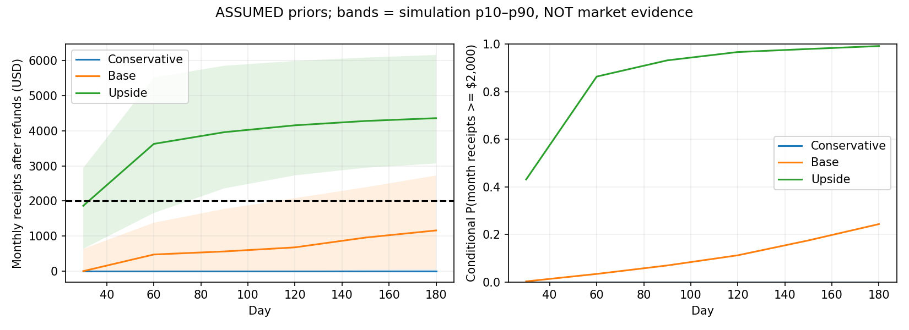

# 07. Условная модель $2 000/month

**Дата проверки: 2026-11-13 (Europe/Kyiv).** Метки: VERIFIED — первичный документ или воспроизводимый тест; OBSERVED — ограниченная выборка; ESTIMATED — расчёт; ASSUMED — допущение; UNKNOWN — данных недостаточно. HTTP 200 сам по себе не подтверждает API, спрос или право автоматизации.

## Что измеряет модель

Реализация: [revenue_model.py](../../research/models/revenue_model.py), полный input manifest — [model_assumptions.json](../../data/model_assumptions.json). Seed `20261113`, 5 000 trajectories/scenario, 6 periods по 30 дней. Все funnel, price, support, lag и churn priors — **ASSUMED**, не эмпирические averages. Ни из конкурентных страниц, ни из GitHub comments не выведены conversion rates. Полученные вероятности — ESTIMATED **при данных допущениях**; у текущего бизнеса нет измеренной вероятности.

Цель = месячные оплаченные receipts после ожидаемых refunds, до fees/tax. Не cumulative sales и не net income. Day 30/60/90/180 — конец соответствующего 30-day периода, не прогноз по точной календарной дате. Показатель `p_reached_by_day` отдельно отражает хотя бы один месячный успех к сроку. Одна удачная продажа не равна устойчивой MRR. Здесь tax исключён, owner salary учитывается отдельно по opportunity cost $20/h.

## Воронка и временные ограничения

`impressions → clicks → service_clicks (80%) → qualified → negotiations → proposals → accepted orders → due after 0/1/2 months → capacity-limited completed+paid → repeats/subscriptions`.

Binomial draws на каждой стадии, Poisson exposures, triangular parameter uncertainty per trajectory; exposure growth compounding capped at 200k/month. 20% clicks — kit lane с отдельной assumed conversion 0.2–2%, $49 kit; не бесплатная бесконечная product revenue. Template fulfillment/support consumes time budget, но нет отдельного proof of product demand.

Negotiations ≤32/month; 0.35h each + 0.15h/proposal. 120h/month total; 24h acquisition/content; build 40h month1 и 4h later. Service delivery triangular; backlog ждёт capacity, ежемесячный assumed expiry 35%; неоплаченные backlog не revenue. Orders staggered по 0/1/2-month lag: Conservative 10/40/50%, Base 35/50/15%, Upside 60/35/5%. Это coarse lag сценарии; нет точного daily cash-flow/депозитов и negotiation-age модели.

Existing clients generate repeat orders с per-trajectory rate 0–10%/month; client age не различается. Subscription attach 5–30% completed clients; starts next month; $39/month; churn 2–20%/month; support 0.5h/sub/month before delivery. Если поддержка превышает обслуживаемую мощность, число accounts урезается, не предполагается infinite MRR. Нет бесконечного ретейнера без труда.

Refund triangle 0/3/10%; fee 5/10/20%; direct service $3/job, kit $0.5/unit; fixed cash $5/month (инфра/AI reserve). Время marketing — CAC трудом, не нулевая стоимость acquisition. Cash ads = $0. `net = gross × (1−refund) × (1−fee) − direct_cost − $5`. Fees предполагаются на net receipts; невозвращаемые payment/refund fees и chargebacks могут сделать хуже. Ни $5 reserve, ни trial API не гарантируют бесплатный production.

## Inputs: диапазоны не benchmarks

| Параметр | Conservative min/mode/max | Base | Upside |
| --- | --- | --- | --- |
| Первый месяц exposures | 300 / 700 / 1400 | 1000 / 2400 / 4500 | 2500 / 5000 / 10000 |
| Monthly exposure growth | 0 / 8 / 20% | 5 / 18 / 35% | 10 / 30 / 50% |
| CTR | 0.8 / 1.8 / 3% | 1.5 / 3 / 5% | 2 / 4 / 6.5% |
| Qualified/click | 3 / 7 / 12% | 5 / 12 / 20% | 8 / 16 / 25% |
| Negotiation/qualified | 35 / 50 / 65% | 50 / 70 / 85% | 60 / 80 / 90% |
| Proposal/negotiation | 40 / 60 / 75% | 55 / 75 / 90% | 65 / 80 / 95% |
| Close/proposal | 8 / 15 / 25% | 15 / 28 / 40% | 20 / 35 / 50% |
| Ticket USD | 180 / 300 / 500 | 300 / 500 / 800 | 400 / 650 / 1000 |
| Delivery hours | 12 / 18 / 28 | 8 / 12 / 20 | 6 / 10 / 16 |

Conservative соответствует слабому трафику/долгим сделкам, **не** measured Ukrainian market. Upside одновременно предполагает хороший трафик, высокую qualification, более быстрый delivery и лучший чек; это aspirational stress case. Priors между параметрами независимы внутри сценария: реальные корреляции «больше чек→меньше conversion/больше сложность» могут снизить результат. Не использовать Upside как base.

## Результат текущего запуска

| Сценарий | Day | P(текущий месяц ≥$2k) | P(хотя бы один месяц к сроку) | Revenue p10 / p50 / p90, $ | Median net $ | Median net $/h |
| --- | --- | --- | --- | --- | --- | --- |
| Conservative | 30 | 0.00% | 0.00% | 0 / 0 / 0 | -5 | -0.1 |
| Conservative | 60 | 0.00% | 0.00% | 0 / 0 / 0 | -5 | -0.2 |
| Conservative | 90 | 0.00% | 0.00% | 0 / 0 / 0 | -5 | -0.2 |
| Conservative | 180 | 0.00% | 0.00% | 0 / 0 / 46 | -5 | -0.2 |
| Base | 30 | 0.22% | 0.22% | 0 / 0 / 635 | -5 | -0.1 |
| Base | 60 | 3.36% | 3.54% | 0 / 474 / 1380 | 409 | 9.1 |
| Base | 90 | 6.92% | 9.48% | 0 / 561 / 1774 | 487 | 10.7 |
| Base | 180 | 24.32% | 37.10% | 47 / 1160 / 2727 | 1016 | 15.2 |
| Upside | 30 | 43.08% | 43.08% | 635 / 1864 / 2941 | 1624 | 15.0 |
| Upside | 60 | 86.36% | 88.46% | 1658 / 3629 / 5524 | 3176 | 31.0 |
| Upside | 90 | 93.18% | 96.80% | 2360 / 3963 / 5857 | 3483 | 32.2 |
| Upside | 180 | 99.20% | 99.94% | 3069 / 4362 / 6165 | 3827 | 33.9 |

[CSV](../../data/revenue_scenarios.csv) также содержит stage counts, completed, backlog, support, MRR, hours и economic profit. Wilson 95% MC intervals отражают **только sampling error** данной симуляции, не достоверность priors. При zero successes из 5000 истинная условная вероятность не доказана равной нулю: rule-of-three bound около 0.06%. Условный Base day90 около 7%, day180 около 24%; median Base day180 ниже цели. План не может обещать $2k при этих priors.

## Чувствительность: где важнее измерение

[revenue_sensitivity.csv](../../data/revenue_sensitivity.csv) — ±25% one-at-a-time по 14 параметрам, seed тот же, Base day90. Одинаковый seed не гарантирует идеально paired random variates после branch-dependent binomial draws; это exploratory local sensitivity, не Sobol decomposition/causal effect.

| Параметр | Multiplier | P day90 | Изменение |
| --- | --- | --- | --- |
| ticket | 1.25 | 12.64% | +5.72 п.п. |
| impressions | 1.25 | 11.56% | +4.64 п.п. |
| ctr | 1.25 | 11.40% | +4.48 п.п. |
| qualification | 1.25 | 11.34% | +4.42 п.п. |
| close | 1.25 | 11.20% | +4.28 п.п. |
| ticket | 0.75 | 2.70% | -4.22 п.п. |
| negotiation | 1.25 | 11.12% | +4.20 п.п. |
| proposal | 1.25 | 10.82% | +3.90 п.п. |
| ctr | 0.75 | 3.30% | -3.62 п.п. |
| impressions | 0.75 | 3.48% | -3.44 п.п. |

Основные измеряемые неизвестные: **accepted ticket, qualified exposure volume (impressions×CTR), qualification, close rate, delivery hours/lag**. В текущем demand-constrained Base delivery capacity часто простаивает, поэтому добавлять worker/AI features преждевременно. Формально отдельные proposal/negotiation rates тоже значимы; они включены в CSV, а не скрыты за top-five summary. Чувствительность денежного net к комиссиям не обязана менять revenue threshold до fees.

## Минимальный поток, чек и мощность

ESTIMATED deterministic illustration, не forecast: при $500 ticket/refund3% нужно `ceil(2000/(500×.97))=5` completed paid jobs/month (4 дают $1940). При $350 нужно 6; при $650 нужно 4. Для $2000 **net** при fee10%, direct cost $3/job, fixed$5, 5 jobs нужен ticket `(2000+15+5)/(5×.97×.9) ≈ $462.77`; до налогов и не salary-adjusted. Для $2000 revenue и 4 jobs нужен средний чек ≥$515.47; fee не меняет gross-revenue threshold, но меняет net.

При Base modal rates service orders/impression `0.8×.03×.12×.7×.75×.28 = .00042336`; на 5 orders нужно примерно 11 810 targeted impressions/month в steady state до capacity/loss/delay. Это **не** количество холодных сообщений и не разрешение их отправлять. При таком же funnel на 5 orders около 354 clicks, 34 qualified, 24 negotiations и 18 proposals; таблица округлена, реальные binomial outcomes нестабильны. Если личных qualified leads уже 10/month и half reach proposal с close30%, ожидаемые 1.5 orders — недостаточно для 5.

При 120h и 24 marketing+4 ongoing build+12 presales+5 support остаётся 75h fulfillment: 5 jobs → max15h/job. Для $2000 net за 120h нужен минимум $16.67/h; для $2000 **после** opportunity cost $20/h нужно $4400 contribution/month, гораздо сложнее. Модель не смешивает выручку и личный доход.

Catalog P01: $350 → cash contribution $302.55, delivery+first support 9h=$180, remaining $122.55; reusable build12h=$240 → примерно 2 jobs до покрытия build при этих assumptions, **без маркетинга**. P04: $600 → $520.80 cash, 15h labor=$300, $220.80 residual; build16h=$320 → 2 jobs. P05 kit: $49 → catalog cash $39.78, 0.5h labor=$10, build24h=$480 → 17 sales до labor-adjusted recovery. Бесплатное распространение 17 targeted paid licenses не доказано. Cash break-even alone would hide acquisition labor.

Fee sensitivity: $500 receipt/refund3% даёт $436.50 before $3 costs при fee10%, $388 при20%, $339.50 при30%. Gumroad Discover actual observed fee30% ([pricing](https://gumroad.com/pricing)) нельзя подставлять как 10%. Direct fee10%+$0.50; Lemon Squeezy base5%+$0.50 plus possible extras — [05](05_DISTRIBUTION_CHANNELS.md). Бюджет $0 infra не устраняет marketplace/KYC/withdrawal expenses.

## Ноль продаж первые 30 дней

[revenue_no_sales_month1.csv](../../data/revenue_no_sales_month1.csv) принудительно обнуляет accepted service orders и kit sales month1; acquisition/build time и $5 cash cost остаются. Day90 Base probability: 5.12%; day180: 22.98%. Это изолированное вмешательство, а не модель demotivation, отсутствия дальнейшего traffic или cash runway. Нужен личный runway, которого задача не задаёт; нельзя считать full-time founder salary бесплатной.

## Оптимизация и ограничения

[portfolio_optimizer.py](../../research/models/portfolio_optimizer.py) перебирает bounded integer offers с demand caps, 120h, cash ≤$10/month, build ≤70h over launch window, shared dependencies. P03 исключён по умолчанию до security qualification. 24h marketing и build/6 amortization включены; no unlimited template sales. Отдельные service units/будущие rollouts не разрешены данным PR. Результаты — [10](10_PORTFOLIO_STRATEGY.md).

Модель требует последующей калибровки: записать channel cohorts, реальные delay/price/support и Bayesian/binomial intervals, учесть country/segment covariance и lost deals. 15 unit tests проверяют accounting, zero demand/capacity, funnel counts, deterministic seed, no month1 sales, fee effects, portfolio constraints и state invariants. Они подтверждают расчёты, **не** priors или будущую прибыль.
